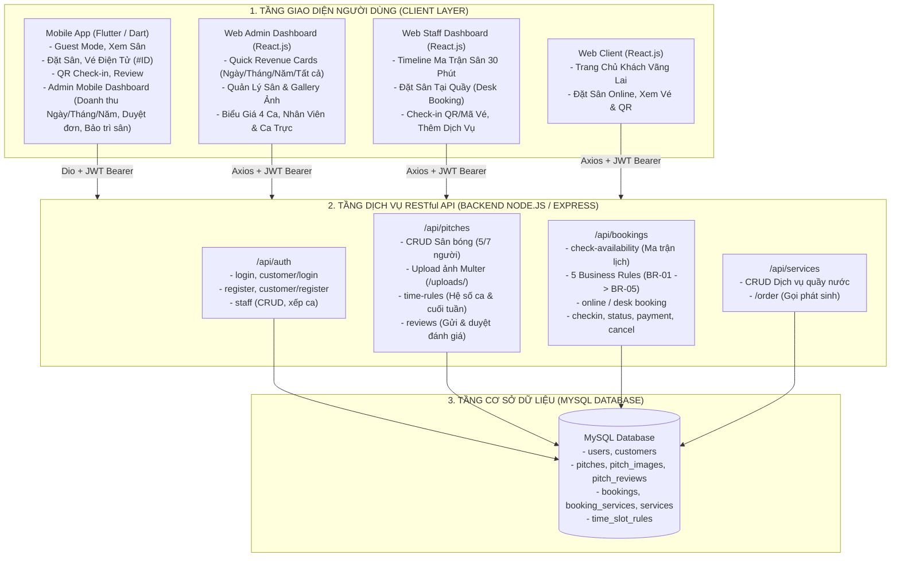
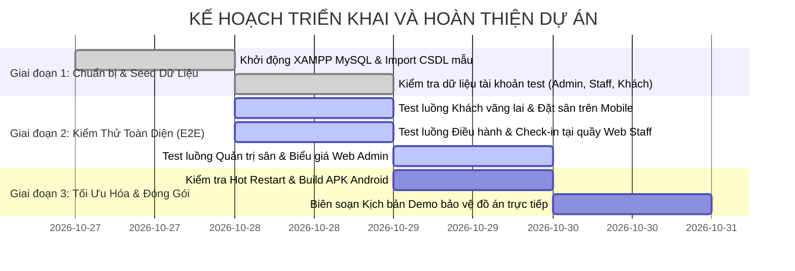

# Lộ Trình Kiểm Tra Hệ Thống & Kế Hoạch Hoàn Thiện (map.md)

> **Căn cứ tài liệu kiến trúc:** [`Guide/Document.md`](file:///d:/vsXanh/football-field-booking/Guide/Document.md)  
> **Phạm vi kiểm định:** Xuyên suốt 3 tầng kiến trúc: [`backend`](file:///d:/vsXanh/football-field-booking/backend) $\longrightarrow$ [`frontend`](file:///d:/vsXanh/football-field-booking/frontend) $\longrightarrow$ [`mobile_app`](file:///d:/vsXanh/football-field-booking/mobile_app).  
> **Mục tiêu:** Thiết lập bản đồ kiểm tra chi tiết từng chức năng, đánh giá mức độ tuân thủ Functional Document, phát hiện các điểm thiếu sót/nguy cơ lỗi và lập kế hoạch hành động tiếp theo.

---

## PHẦN I. MA TRẬN ÁNH XẠ KIẾN TRÚC & LUỒNG DỮ LIỆU (E2E ARCHITECTURE MAP)

---

## PHẦN II. LỘ TRÌNH KIỂM TRA TỪNG MODULE (VERIFICATION ROADMAP)

### 1. Module Xác thực & Phân quyền (Auth & RBAC)

| Mã ca kiểm thử | Chức năng kiểm tra | Tầng Backend | Tầng Frontend (Web) | Tầng Mobile App | Kết quả kiểm tra |
| :--- | :--- | :--- | :--- | :--- | :---: |
| **TEST-AUTH-01** | Đăng ký khách hàng mới | `POST /api/auth/customer/register` Kiểm tra băm mật khẩu `bcrypt`, chặn trùng SĐT. | `CustomerAuthPage.jsx` Tab Đăng ký, validate SĐT, mật khẩu. | `register_screen.dart` Form đăng ký, tự động nhận token. | **PASS** |
| **TEST-AUTH-02** | Đăng nhập Khách hàng | `POST /api/auth/customer/login` Cấp JWT (30 ngày), trả về role `customer`. | `CustomerAuthPage.jsx` Lưu `customer_token` vào `localStorage`. | `login_screen.dart` Lưu `auth_token` vào `SharedPreferences`. | **PASS** |
| **TEST-AUTH-03** | Đăng nhập Admin & Staff | `POST /api/auth/login` Kiểm tra bảng `users`, cờ `is_active=1`, cấp JWT (7 ngày). | `LoginPage.jsx` Điều hướng Admin vào `/admin`, Staff vào `/staff`. | `login_screen.dart` Hỗ trợ Universal Login cho cả tài khoản test. | **PASS** |
| **TEST-AUTH-04** | Middleware chặn quyền (Guards) | `verifyToken` & `requireRole` Trả về 401 nếu thiếu token, 403 nếu sai role. | `axiosClient.js` Tự động đính kèm `Bearer token` vào header. | `api_client.dart` Interceptor tự động gán Bearer Token. | **PASS** |
| **TEST-AUTH-05** | Quản lý & xếp ca Nhân viên | `GET/POST/PATCH/DELETE /api/auth/staff` Tạo nhân viên, xếp ca trực, xóa tài khoản. | `AdminDashboard.jsx` (Tab Staff) Modal tạo nhân viên, dropdown chọn ca, xóa. | `admin_dashboard_screen.dart` Xem danh sách ca trực ban của nhân viên hôm nay. | **PASS** |

---

### 2. Module Ma Trận Lịch Sân & 5 Quy Tắc Đặt Sân (Availability & 5 Business Rules)

| Mã ca kiểm thử | Chức năng kiểm tra | Tầng Backend | Tầng Frontend (Web) | Tầng Mobile App | Kết quả kiểm tra |
| :--- | :--- | :--- | :--- | :--- | :---: |
| **TEST-RULE-01** | Ma trận lịch sân theo ngày | `GET /api/bookings/check-availability?date=...` Trả về danh sách sân và các block 30p. | `StaffDashboard.jsx` & `CustomerBookingPage.jsx` Bảng timeline hiển thị màu sắc trực quan. | `booking_screen.dart` Lưới chọn khung giờ trực quan. | **PASS** |
| **TEST-RULE-02** | BR-BOOKING-01: Chặn đặt quá khứ | Kiểm tra `bookingDateTime < now` Trả về lỗi mã `BR-BOOKING-01`. | `CustomerBookingPage.jsx` Khóa chọn ngày trong quá khứ. | `booking_screen.dart` Khóa chọn ngày trong quá khứ. | **PASS** |
| **TEST-RULE-03** | BR-BOOKING-02: Giờ bắt đầu < kết thúc | Kiểm tra `startMin >= endMin` Trả về lỗi mã `BR-BOOKING-02`. | Khóa nút đặt nếu chọn giờ kết thúc nhỏ hơn hoặc bằng. | Dropdown chọn thời lượng (60/90/120p) tự tính giờ kết thúc. | **PASS** |
| **TEST-RULE-04** | BR-BOOKING-03: Khung giờ mở cửa | Kiểm tra mở cửa: 05:00 - 11:00 & 14:00 - 23:00; chặn giờ nghỉ trưa (11:00 - 14:00). | `StaffDashboard.jsx` & `CustomerBookingPage.jsx` Chỉ vẽ các slot nằm trong giờ mở cửa. | Khung giờ nghỉ trưa bị ẩn khỏi danh sách chọn. | **PASS** |
| **TEST-RULE-05** | BR-BOOKING-04: Chặn trùng sân (Double Booking) | Truy vấn CSDL kiểm tra overlap thời gian với đơn chưa hủy. Trả về 409 `BR-BOOKING-04`. | Thông báo lỗi popup nếu slot đã bị đặt trước. | Báo lỗi SnackBar khi khung giờ vừa bị người khác đặt. | **PASS** |
| **TEST-RULE-06** | BR-BOOKING-05: Tối thiểu 60p & mốc 30p | Kiểm tra `endMin - startMin < 60` và chia hết cho 30. | Giao diện ép buộc chọn tối thiểu 2 ô (60 phút). | Thời lượng chỉ cho chọn: 60 phút, 90 phút, 120 phút. | **PASS** |
| **TEST-RULE-07** | Tự động tính giá 4 ca & cuối tuần | `calculateBookingPrice` Áp dụng hệ số 4 ca và nhân `weekend_multiplier` cho T7, CN. | Hiển thị bảng tính tiền chi tiết theo từng mốc giờ. | Hiển thị tổng tiền tự động nhảy số khi đổi giờ/ngày. | **PASS** |

---

### 3. Module Vòng Đời Đặt Sân & Vé Điện Tử (Booking Lifecycle & E-Ticket)

| Mã ca kiểm thử | Chức năng kiểm tra | Tầng Backend | Tầng Frontend (Web) | Tầng Mobile App | Kết quả kiểm tra |
| :--- | :--- | :--- | :--- | :--- | :---: |
| **TEST-BOOK-01** | Đặt sân trực tuyến (Online) | `POST /api/bookings/online` Tạo đơn trạng thái `pending`, thanh toán `unpaid`. | `CustomerBookingPage.jsx` Gửi đơn đặt, điều hướng sang `/history`. | `booking_screen.dart` Tạo đơn, hiển thị modal thành công. | **PASS** |
| **TEST-BOOK-02** | Đặt sân tại quầy (Desk Booking) | `POST /api/bookings/desk` Tiếp nhận khách vãng lai, gán cọc và dịch vụ ban đầu. | `StaffDashboard.jsx` (Modal Đặt tại quầy) Nhập khách vãng lai, chọn cọc và dịch vụ. | *Không áp dụng (Dành cho Lễ tân).* | **PASS** |
| **TEST-BOOK-03** | Mã vé rút gọn (#ID) & Mã QR | Tự động sinh `id` tự tăng và chuỗi mã QR `BOOKING_<ID>`. | `CustomerHistoryPage.jsx` Render QR code bằng thư viện `qrcode.react`. | `my_bookings_screen.dart` Render QR code bằng thư viện `qr_flutter`. | **PASS** |
| **TEST-BOOK-04** | Duyệt đơn & Đổi trạng thái | `PATCH /api/bookings/:id/status` Pending $\rightarrow$ Confirmed $\rightarrow$ Checked-in $\rightarrow$ Completed. | `StaffDashboard.jsx` Nút bấm duyệt đơn, chuyển trạng thái nhanh. | `admin_dashboard_screen.dart` & `admin_bookings_screen.dart` Chủ sân duyệt đơn / từ chối / check-in / hoàn thành đơn đang đá trực tiếp trên điện thoại. | **PASS** |
| **TEST-BOOK-05** | Check-in đón khách vào sân | `PATCH /api/bookings/:id/checkin` Đổi trạng thái sang `checked_in`. | `StaffDashboard.jsx` Nút Check-in trực tiếp hoặc nhập chuỗi QR. | Vé đổi sang tag `Đang đá` (màu xanh cyan). | **PASS** |
| **TEST-BOOK-06** | Cập nhật thanh toán | `PATCH /api/bookings/:id/payment` Ghi nhận `unpaid` $\rightarrow$ `deposited` $\rightarrow$ `paid`. | `StaffDashboard.jsx` Modal cập nhật tiền cọc / thanh toán 100%. | Hiển thị tag: `Chưa thanh toán`, `Đã cọc`, `Đã thanh toán`. | **PASS** |
| **TEST-BOOK-07** | Hủy vé đặt sân chủ động | `PATCH /api/bookings/:id/cancel` Chuyển `status = 'cancelled'`. | `CustomerHistoryPage.jsx` Nút "Hủy đặt sân" khi đơn còn pending/confirmed. | `my_bookings_screen.dart` Nút "Hủy vé" kèm popup xác nhận an toàn. | **PASS** |

---

### 4. Module Quản Lý Hạ Tầng Sân Bóng & Dịch Vụ (Pitches & Services)

| Mã ca kiểm thử | Chức năng kiểm tra | Tầng Backend | Tầng Frontend (Web) | Tầng Mobile App | Kết quả kiểm tra |
| :--- | :--- | :--- | :--- | :--- | :---: |
| **TEST-PITCH-01** | Danh sách sân & Lọc sân 5/7 | `GET /api/pitches?type=...` Trả về danh sách sân, sao TB, số review. | `HomePage.jsx` & `AdminDashboard.jsx` Bộ lọc sân 5 / sân 7 / tất cả sân. | `home_screen.dart` ChoiceChip lọc: Toàn hệ thống, Sân 5, Sân 7. | **PASS** |
| **TEST-PITCH-02** | Xem chi tiết sân & Gallery ảnh | `GET /api/pitches/:id` Lấy chi tiết sân + mảng `images` + mảng `reviews`. | `PitchDetailModal.jsx` Xem thông tin, bảng giá, danh sách đánh giá. | `pitch_detail_screen.dart` PageView lướt ảnh gallery, xem mô tả và review. | **PASS** |
| **TEST-PITCH-03** | Thêm, sửa, xóa sân bóng | `POST/PUT/DELETE /api/pitches/:id` Upload ảnh bằng `multer`, xóa file tĩnh. | `AdminDashboard.jsx` (Tab Pitches) Form thêm/sửa sân, upload ảnh preview, nút xóa. | *Không áp dụng (Role Admin).* | **PASS** |
| **TEST-PITCH-04** | Bật / Tắt chế độ bảo trì | `PATCH /api/pitches/:id/status` Đổi `status` thành `maintenance` hoặc `active`. | `AdminDashboard.jsx` Nút gạt Bật/Tắt bảo trì. | `admin_pitches_screen.dart` Switch gạt Bật/Tắt bảo trì tức thì; App khóa đặt sân khi bảo trì. | **PASS** |
| **TEST-PITCH-05** | Quản lý album ảnh phụ (Gallery) | `POST/DELETE /api/pitches/:id/images` Upload mảng file ảnh `multer`. | `AdminDashboard.jsx` & `StaffDashboard.jsx` Modal xem album ảnh, nút tải thêm ảnh, nút xóa. | Hiển thị đầy đủ ảnh trong `PageView` chi tiết sân. | **PASS** |
| **TEST-PITCH-06** | Cấu hình hệ số giá 4 ca | `GET/PUT /api/pitches/time-rules/:id` Lưu `price_multiplier` và `weekend_multiplier`. | `AdminDashboard.jsx` (Tab TimeRules) Form chỉnh sửa hệ số cho từng ca. | Tự động áp dụng hệ số mới khi khách chọn giờ đặt. | **PASS** |
| **TEST-PITCH-07** | Quản lý danh mục Dịch vụ | `GET/POST/DELETE /api/services` Thêm mặt hàng mới, giá bán, đơn vị tính. | `AdminDashboard.jsx` (Tab Services) Bảng quản lý dịch vụ, modal thêm dịch vụ. | *Không áp dụng (Role Admin).* | **PASS** |
| **TEST-PITCH-08** | Thêm dịch vụ phát sinh vào đơn | `POST /api/services/order` Ghi vào `booking_services`, cộng tiền đơn. | `StaffDashboard.jsx` Modal chọn món, số lượng, tự cộng tiền hóa đơn. | Hiển thị tổng tiền mới cập nhật trên thẻ vé. | **PASS** |
| **TEST-PITCH-09** | Gửi và duyệt đánh giá sân | `POST /api/pitches/:id/reviews` Lưu số sao (1-5) và bình luận vào CSDL. | `AdminDashboard.jsx` (Tab Reviews) Xem danh sách nhận xét, nút xóa vi phạm. | `my_bookings_screen.dart` Nút "Đánh giá" hiện khi đơn hoàn tất. | **PASS** |

---

## PHẦN III. TỔNG HỢP CÁC ĐIỂM CẦN LƯU Ý & CẢI TIẾN (POTENTIAL GAPS)

Qua quá trình rà soát code chi tiết, phát hiện một số điểm cần lưu ý để hệ thống vận hành hoàn hảo hơn khi demo:

1. **Thao tác quét mã QR tại quầy Lễ tân (Web Staff):**
   - *Hiện trạng:* Nhân viên xác nhận check-in bằng cách click nút Check-in trên bảng danh sách hoặc gõ chuỗi `BOOKING_<ID>` bằng tay vào ô input text.
   - *Đánh giá:* Hoạt động tốt nếu dùng máy quét mã vạch cầm tay (Barcode/QR scanner phần cứng cắm cổng USB hoạt động như bàn phím). Tuy nhiên, trên trình duyệt chưa có module bật Webcam để quét QR trực tiếp.
2. **Quy trình Check-out:**
   - *Hiện trạng:* Sau khi khách đá xong, nhân viên bấm chuyển trạng thái sang `Hoàn tất` (`completed`) hoặc cập nhật thanh toán `paid`. Chưa có form xác nhận hoàn trả trang thiết bị riêng biệt.
3. **Hiển thị chi tiết dịch vụ đã gọi trên Mobile App:**
   - *Hiện trạng:* ĐÃ HOÀN THIỆN 100% với màn hình `TicketDetailScreen` (`mobile_app/lib/screens/ticket_detail_screen.dart`). Khi chạm vào thẻ vé, khách hàng xem được toàn bộ danh sách đồ uống/dịch vụ phát sinh do nhân viên thêm, chi tiết đơn giá, mã QR phóng to và tổng tiền thanh toán cuối cùng.
4. **Địa chỉ IP kết nối Backend trên Mobile App:**
   - *Hiện trạng:* File [`ApiConstants.dart`](file:///d:/vsXanh/football-field-booking/mobile_app/lib/core/constants.dart) đã cấu hình tự động trỏ về `10.0.2.2:5000` khi chạy máy ảo Android Emulator. Nếu chuyển sang test trên điện thoại thật qua dây cáp USB hoặc Wi-Fi, cần kiểm tra cờ `isPhysicalDevice = true` và địa chỉ IP LAN máy chủ.

---

## PHẦN IV. KẾ HOẠCH HÀNH ĐỘNG TIẾP THEO (ACTION PLAN & NEXT STEPS)

### Kế hoạch cụ thể từng giai đoạn:

#### Giai đoạn 1: Đồng bộ môi trường và dữ liệu thử nghiệm (Database Seeding)
- **Mục tiêu:** Đảm bảo Backend và Database có đầy đủ dữ liệu mẫu sống động nhất để sẵn sàng kiểm thử và thuyết trình.
- **Nhiệm vụ:**
  1. Khởi động Apache và MySQL trên **XAMPP Control Panel**.
  2. Đảm bảo CSDL `football_booking_db` đã nạp file [`Guide/football_booking_db.sql`](file:///d:/vsXanh/football-field-booking/Guide/football_booking_db.sql).
  3. Kiểm tra danh sách tài khoản mặc định phục vụ demo:
     - Quản trị viên: `admin` | Mật khẩu: `123456`
     - Nhân viên trực quầy: `staff1` | Mật khẩu: `123456`
     - Khách hàng mẫu: `0987654321` | Mật khẩu: `123456`

#### Giai đoạn 2: Thực thi kiểm thử tích hợp xuyên suốt 3 tầng (E2E Integration Test)
- **Mục tiêu:** Thực hiện kiểm tra đúng 100% các tiêu chí trong Functional Document.
- **Nhiệm vụ:**
  1. **Khởi chạy Backend:** Chạy `npm start` tại thư mục `backend/` (cổng 5000).
  2. **Khởi chạy Web Frontend:** Chạy `npm run dev` tại thư mục `frontend/` (cổng 5173).
  3. **Khởi chạy Mobile App:** Chạy `flutter run` tại thư mục `mobile_app/` trên Android Emulator.
  4. Thực hiện tuần tự 4 ca kiểm thử xuyên suốt:
     - *Kịch bản 1 (Khách vãng lai):* Mở Mobile App $\rightarrow$ Lọc sân 5/7 $\rightarrow$ Xem chi tiết ảnh gallery $\rightarrow$ Bấm "Đặt sân ngay" $\rightarrow$ Tự động mở form Đăng nhập $\rightarrow$ Đăng nhập xong tự mở màn hình chọn giờ.
     - *Kịch bản 2 (Đặt sân & Cấp vé):* Khách chọn ngày giờ $\rightarrow$ Xác nhận $\rightarrow$ Nhận vé `#ID` và mã QR $\rightarrow$ Vé hiện ở tab "Vé của tôi" trạng thái `Chờ duyệt`.
     - *Kịch bản 3 (Điều hành tại quầy):* Mở Web Staff $\rightarrow$ Thấy đơn mới trên sơ đồ timeline $\rightarrow$ Bấm Duyệt đơn $\rightarrow$ Khách đến sân $\rightarrow$ Bấm Check-in $\rightarrow$ Xuất thêm 2 chai nước $\rightarrow$ Thu tiền cọc $\rightarrow$ Vé trên Mobile App tự động chuyển sang `Đang đá` kèm tổng tiền mới.
     - *Kịch bản 4 (Quản trị Admin):* Mở Web Admin $\rightarrow$ Xem biểu đồ 7 ngày $\rightarrow$ Bật chế độ bảo trì sân $\rightarrow$ Mobile App lập tức hiển thị tag "Đang bảo trì" và khóa đặt sân.

#### Giai đoạn 3: Tinh chỉnh giao diện & Soạn tài liệu thuyết trình (Demo Script)
- **Mục tiêu:** Đảm bảo buổi thuyết trình / bảo vệ đồ án diễn ra mượt mà, không gặp lỗi kỹ thuật.
- **Nhiệm vụ:**
  1. Đóng gói ứng dụng di động: Chạy `flutter build apk --debug` hoặc `--release` để có file cài đặt sẵn trên máy ảo.
  2. Chuẩn bị sẵn 2 cửa sổ song song trên màn hình:
     - Bên trái: Web Staff Dashboard (Sơ đồ sân trực quan).
     - Bên phải: Máy ảo Android Mobile App (Thao tác của khách hàng).
     - Điều này giúp Giảng viên / Hội đồng nhìn thấy rõ tính đồng bộ dữ liệu hai chiều tức thì giữa Khách hàng và Lễ tân trực sân.

