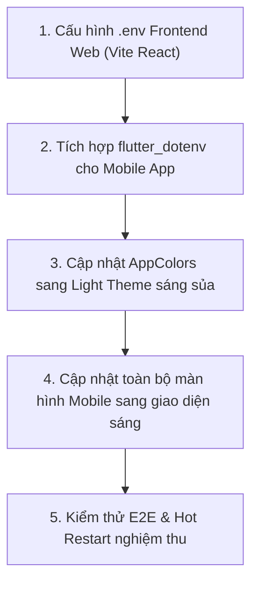

# KẾ HOẠCH & LỘ TRÌNH PHÁT TRIỂN DỰ ÁN (TODO.MD)

> **Dự án:** Hệ thống Quản lý và Đặt sân bóng đá mini cỏ nhân tạo  
> **Nền tảng:** Web React.js & Mobile App Flutter & Backend RESTful API Node.js/Express + MySQL  
> **Cập nhật ngày:** 27/10/2026

---

## BẢNG TỔNG QUAN TIẾN ĐỘ THỰC HIỆN

| Phân hệ / Mục tiêu | Trạng thái | Ghi chú hoàn thành |
| :--- | :---: | :--- |
| **Mục 1:** Chuyển đổi lưu trữ ảnh sang Base64 | <span style="color:green">**HOÀN THÀNH**</span> | Đã migrate CSDL sang `LONGTEXT`, backend tự encode Base64, mobile render `AppImage`. |
| **Mục 2:** Xử lý xung đột đặt trùng giờ (Concurrency) | <span style="color:green">**HOÀN THÀNH**</span> | Đã áp dụng MySQL Transaction + Pessimistic Lock (`SELECT ... FOR UPDATE`) + `BR-BOOKING-04`. |
| **Mục 3:** Box thông báo sau khi đánh giá sân | <span style="color:green">**HOÀN THÀNH**</span> | Đã hiển thị Alert Box popup chúc mừng kèm số sao và icon tích xanh. |
| **Mục 4:** Cấu hình `.env` cho Frontend Web (React) & Mobile App | <span style="color:orange">**ĐANG LÊN KẾ HOẠCH**</span> | Chuẩn hóa biến môi trường, dùng `flutter_dotenv` cho Mobile & `VITE_` cho Web. |
| **Mục 5:** Nâng cấp toàn diện Giao diện Sáng (Bright / Light Theme) | <span style="color:orange">**ĐANG LÊN KẾ HOẠCH**</span> | Chuyển đổi bảng màu Dark sang Light Theme thể thao tươi sáng, thoáng đãng, dễ đọc. |

---

## PHẦN I. CÁC HẠNG MỤC ĐÃ HOÀN THÀNH

### Giai đoạn 1: Nâng cấp Cấu trúc CSDL MySQL (Database Migration)
- [x] **1.1.** Cập nhật cột `avatar_url` trong bảng `pitches` từ `VARCHAR(255)` sang `LONGTEXT` để đủ dung lượng chứa chuỗi Base64.
- [x] **1.2.** Cập nhật cột `image_url` trong bảng `pitch_images` từ `VARCHAR(255)` sang `LONGTEXT`.
- [x] **1.3.** Cập nhật cột `avatar_url` trong bảng `customers` sang `LONGTEXT`.
- [x] **1.4.** Cập nhật file schema gốc [`Guide/football_booking_db.sql`](file:///d:/vsXanh/football-field-booking/Guide/football_booking_db.sql).

### Giai đoạn 2: Migrate Dữ liệu Ảnh Hiện Có & Nâng Cấp Backend (Node.js)
- [x] **2.1. Viết script migration dữ liệu ([`scripts/migrate_images_to_base64.js`](file:///d:/vsXanh/football-field-booking/scripts/migrate_images_to_base64.js)):**
  - Quét toàn bộ file ảnh hiện có trong thư mục tĩnh `backend/uploads/pitches/`.
  - Mã hóa sang định dạng chuỗi: `data:image/jpeg;base64,...`.
  - Cập nhật thành công 100% vào các bản ghi trong bảng `pitches` và `pitch_images`.
- [x] **2.2. Nâng cấp API thêm/sửa sân bóng ([`pitchController.js`](file:///d:/vsXanh/football-field-booking/backend/controllers/pitchController.js)):**
  - Tự động mã hóa ảnh Multer sang Base64 Data URI lưu thẳng vào CSDL.
  - Bổ sung alias `p.avatar_url AS image` để đồng bộ với Flutter model.
- [x] **2.3. Chống Race Condition khi 2 khách cùng bấm đặt 1 lúc:**
  - Áp dụng MySQL Transaction + Pessimistic Lock (`SELECT ... FOR UPDATE`) trong `createOnlineBooking` và `createDeskBooking`.
  - Trả về mã HTTP 409 Conflict với thông báo: `"[BR-BOOKING-04] Khung giờ này vừa có khách hàng khác nhanh tay đặt trước. Vui lòng chọn khung giờ khác!"`.

### Giai đoạn 3: Nâng Cấp Ứng Dụng Mobile Flutter (Hiển thị ảnh & Đánh giá)
- [x] **3.1. Xây dựng Widget hiển thị ảnh đa năng ([`mobile_app/lib/widgets/app_image.dart`](file:///d:/vsXanh/football-field-booking/mobile_app/lib/widgets/app_image.dart)):**
  - Tự động phát hiện và giải mã Base64 qua `Image.memory(base64Decode(...))`.
  - Hỗ trợ `base64.normalize(...)` và `gaplessPlayback: true` chống giật nhấp nháy.
- [x] **3.2. Sửa lỗi map trường dữ liệu ([`mobile_app/lib/models/pitch_model.dart`](file:///d:/vsXanh/football-field-booking/mobile_app/lib/models/pitch_model.dart)):**
  - Sửa `image: json['avatar_url'] ?? json['image'] ?? json['avatar']`. Ảnh đại diện chính hiện ngay lập tức 100%.
- [x] **3.3. Sửa lỗi gửi đánh giá & Thêm Box thông báo thành công:**
  - Tự động gửi kèm `customer_name` và `customer_phone` từ `AuthProvider`.
  - Hiển thị Dialog Box nổi bật ở giữa màn hình (icon check xanh, hàng 5 sao vàng, nút Xác nhận & Đóng).

---

## PHẦN II. LỘ TRÌNH MỚI 1: CẤU HÌNH BIẾN MÔI TRƯỜNG .ENV

> **Mục tiêu:** Loại bỏ hoàn toàn việc "hardcode" URL/IP trong mã nguồn, giúp chuyển đổi môi trường tức thì (Localhost $\longleftrightarrow$ Android Emulator $\longleftrightarrow$ Wi-Fi LAN $\longleftrightarrow$ Server Production).

### Giai đoạn 6: Cấu hình file `.env` cho Frontend Web (Vite + React.js)
- [ ] **6.1. Tạo file cấu hình `frontend/.env`:**
  - Khai báo biến môi trường chuẩn Vite:
    ```env
    VITE_API_BASE_URL=http://localhost:5000/api
    VITE_APP_TITLE="Hệ Thống Đặt Sân Bóng Đá Mini"
    ```
- [ ] **6.2. Tạo file mẫu `frontend/.env.example`** để tiện tham khảo khi clone dự án.
- [ ] **6.3. Cập nhật [`frontend/src/api/axiosClient.js`](file:///d:/vsXanh/football-field-booking/frontend/src/api/axiosClient.js):**
  - Thay thế URL tĩnh bằng:
    ```javascript
    baseURL: import.meta.env.VITE_API_BASE_URL || 'http://localhost:5000/api',
    ```
- [ ] **6.4. Kiểm tra `npm run build`** đảm bảo Vite đóng gói biến môi trường trơn tru.

---

### Giai đoạn 7: Tích hợp `flutter_dotenv` cho Mobile App Flutter
- [ ] **7.1. Cài đặt package `flutter_dotenv`:**
  - Thêm dependency `flutter_dotenv: ^5.2.1` vào [`mobile_app/pubspec.yaml`](file:///d:/vsXanh/football-field-booking/mobile_app/pubspec.yaml).
- [ ] **7.2. Tạo file cấu hình `mobile_app/.env` & `mobile_app/.env.example`:**
  - Khai báo các cấu hình linh hoạt:
    ```env
    # Môi trường chạy máy ảo Android Emulator
    API_URL_ANDROID_EMULATOR=http://10.0.2.2:5000/api
    
    # Môi trường chạy điện thoại thật qua mạng LAN Wi-Fi
    API_URL_PHYSICAL_DEVICE=http://192.168.2.20:5000/api
    
    # Môi trường Web / Desktop
    API_URL_WEB=http://localhost:5000/api
    
    # Cờ bật tắt test thiết bị thật
    IS_PHYSICAL_DEVICE=false
    ```
- [ ] **7.3. Khai báo asset `.env` trong `pubspec.yaml`:**
  - Bổ sung `assets: - .env` để Flutter đóng gói file môi trường vào ứng dụng.
- [ ] **7.4. Khởi tạo tại [`mobile_app/lib/main.dart`](file:///d:/vsXanh/football-field-booking/mobile_app/lib/main.dart):**
  - Gọi `await dotenv.load(fileName: ".env");` trước khi `runApp()`.
- [ ] **7.5. Nâng cấp [`mobile_app/lib/core/constants.dart`](file:///d:/vsXanh/football-field-booking/mobile_app/lib/core/constants.dart):**
  - Đọc các giá trị từ `dotenv.env[...]` kết hợp với cơ chế fallback thông minh.
- [ ] **7.6. Thêm `.env` vào `.gitignore`** và giữ lại `.env.example`.

---

## PHẦN III. LỘ TRÌNH MỚI 2: THIẾT KẾ LẠI GIAO DIỆN SÁNG HƠN (LIGHT / BRIGHT THEME)

> **Mục tiêu:** Chuyển đổi toàn bộ tông màu từ Dark Mode tối (`#0F172A`) sang **Light Theme thể thao tươi sáng, hiện đại, thoáng đãng** (Tone màu: Xanh cỏ sân bóng Emerald `#059669` + Trắng tinh khôi `#FFFFFF` + Nền xám nhẹ dịu mắt `#F8FAFC`). Phù hợp với ứng dụng thể thao ngoài trời, độ tương phản cao, dễ nhìn dưới ánh sáng mạnh.

### Giai đoạn 8: Tái Thiết Kế Hệ Thống Bảng Màu `AppColors`
- [ ] **8.1. Cập nhật bảng màu trong [`mobile_app/lib/core/app_colors.dart`](file:///d:/vsXanh/football-field-booking/mobile_app/lib/core/app_colors.dart):**
  ```dart
  class AppColors {
    // Tông màu chủ đạo: Xanh ngọc lục bảo thể thao tràn đầy năng lượng
    static const Color primary = Color(0xFF059669);      // Emerald 600
    static const Color primaryLight = Color(0xFF10B981); // Emerald 500
    static const Color primaryDark = Color(0xFF047857);  // Emerald 700

    // Hệ màu nền sáng tươi mới (Light Theme)
    static const Color background = Color(0xFFF8FAFC);   // Slate 50 (Nền dịu mắt)
    static const Color surface = Color(0xFFFFFFFF);      // Trắng tinh khiết cho Card/Dialog
    static const Color surfaceLight = Color(0xFFF1F5F9); // Slate 100 (Thanh phân cách/Header card)
    static const Color cardBorder = Color(0xFFE2E8F0);   // Slate 200 (Viền card mảnh tinh tế)

    // Hệ màu chữ tương phản cao, sắc nét, dễ đọc
    static const Color textPrimary = Color(0xFF0F172A);   // Slate 900 (Đen sẫm rõ chữ)
    static const Color textSecondary = Color(0xFF475569); // Slate 600 (Xám đậm trung tính)
    static const Color textMuted = Color(0xFF94A3B8);     // Slate 400 (Chữ ghi chú/mờ)

    // Trạng thái đơn và phản hồi
    static const Color success = Color(0xFF10B981); // Xanh lá
    static const Color warning = Color(0xFFF59E0B); // Vàng cam
    static const Color danger = Color(0xFFEF4444);  // Đỏ tươi
    static const Color info = Color(0xFF0284C7);    // Xanh dương
  }
  ```

---

### Giai đoạn 9: Cập Nhật Giao Diện Sáng Cho Toàn Bộ Màn Hình Mobile Flutter
- [ ] **9.1. Thanh điều hướng & Header chính ([`main_tab_screen.dart`](file:///d:/vsXanh/football-field-booking/mobile_app/lib/screens/main_tab_screen.dart)):**
  - Chuyển `BottomNavigationBar` sang nền trắng sáng với đường viền mảnh `cardBorder` bên trên.
  - Icon và nhãn tab đang chọn: Màu xanh Emerald đậm `AppColors.primary`, tab chưa chọn: Màu xám thanh lịch `AppColors.textMuted`.
- [ ] **9.2. Màn hình Trang Chủ ([`home_screen.dart`](file:///d:/vsXanh/football-field-booking/mobile_app/lib/screens/home_screen.dart)):**
  - Nền toàn trang: `#F8FAFC`.
  - Thanh AppBar: Nền trắng với tiêu đề đen đậm, icon xanh thể thao.
  - Bộ lọc ChoiceChip: Nền trắng viền xám khi chưa chọn; khi chọn đổi sang nền xanh Emerald chữ trắng nổi bật.
  - Card thẻ sân bóng: Nền trắng tinh khôi bo tròn 16px, đổ bóng nhẹ nhàng (`BoxShadow(color: Colors.black.withOpacity(0.04), blurRadius: 10)`), hiển thị hình ảnh sân rõ nét, tag loại sân và nút "Đặt Sân Ngay" nổi bật.
- [ ] **9.3. Màn hình Chi Tiết Sân Bóng ([`pitch_detail_screen.dart`](file:///d:/vsXanh/football-field-booking/mobile_app/lib/screens/pitch_detail_screen.dart)):**
  - Nền trang chuyển sang màu sáng.
  - Card thông số, đơn giá và mô tả cơ sở vật chất hiển thị trên card nền trắng viền mảnh.
  - Danh sách đánh giá sao từ khách hàng: Card trắng, avatar tròn, sao vàng sáng và chữ đen dễ đọc.
  - Nút bấm cố định chân trang "📅 ĐẶT SÂN NGAY": Màu xanh Emerald với bóng đổ tươi sáng.
- [ ] **9.4. Màn hình Chọn Giờ & Đặt Sân ([`booking_screen.dart`](file:///d:/vsXanh/football-field-booking/mobile_app/lib/screens/booking_screen.dart)):**
  - Thanh chọn ngày: Lịch cuộn ngang với ngày chọn mang màu xanh Emerald.
  - Ma trận các ô khung giờ 30 phút:
    * Ô còn trống: Nền trắng viền xanh lá nhạt, chữ đen rõ nét.
    * Ô đang chọn: Nền xanh Emerald, chữ trắng in đậm.
    * Ô đã kín / quá giờ: Nền xám nhạt `#E2E8F0` chữ xám mờ.
  - Hộp tóm tắt tổng tiền: Card trắng viền xanh, hiển thị giá tiền to rõ ràng.
- [ ] **9.5. Màn hình Vé Của Tôi ([`my_bookings_screen.dart`](file:///d:/vsXanh/football-field-booking/mobile_app/lib/screens/my_bookings_screen.dart)):**
  - Thiết kế lại thẻ vé phong cách Boarding Pass thể thao trên nền trắng sáng:
    * Header vé: Viền xanh ngọc, tag trạng thái rõ ràng (Chờ duyệt: cam nhạt, Đã duyệt: xanh lá, Hoàn tất: xanh ngọc).
    * Mã QR Code hiển thị trên nền trắng viền bo tròn sạch đẹp.
    * Các vạch đục lỗ vé: Chuyển sang chấm đứt xám nhạt tinh tế.
    * Nút "Xem Chi Tiết Vé & Dịch Vụ": Thanh nền xám nhạt `#F1F5F9` chữ xanh chủ đạo.
- [ ] **9.6. Màn hình Chi Tiết Vé Điện Tử ([`ticket_detail_screen.dart`](file:///d:/vsXanh/football-field-booking/mobile_app/lib/screens/ticket_detail_screen.dart)):**
  - Toàn bộ tấm vé điện tử hiển thị trên nền trắng sáng đổ bóng mềm mại.
  - Bảng kê chi phí và danh sách dịch vụ quầy phát sinh: Bảng phân dòng trắng xen kẽ xám nhạt, tổng tiền in đậm nổi bật.
- [ ] **9.7. Màn hình Quản trị Chủ Sân ([`admin_dashboard_screen.dart`](file:///d:/vsXanh/football-field-booking/mobile_app/lib/screens/admin_dashboard_screen.dart), [`admin_bookings_screen.dart`](file:///d:/vsXanh/football-field-booking/mobile_app/lib/screens/admin_bookings_screen.dart), [`admin_pitches_screen.dart`](file:///d:/vsXanh/football-field-booking/mobile_app/lib/screens/admin_pitches_screen.dart)):**
  - Các thẻ KPI Quick Revenue Cards hiển thị trên nền trắng bóng đổ nhẹ, số liệu doanh thu màu xanh nổi bật.
  - Biểu đồ 7 ngày hiển thị trên nền sáng rõ nét.
- [ ] **9.8. Màn hình Đăng Nhập & Đăng Ký ([`login_screen.dart`](file:///d:/vsXanh/football-field-booking/mobile_app/lib/screens/login_screen.dart), [`register_screen.dart`](file:///d:/vsXanh/football-field-booking/mobile_app/lib/screens/register_screen.dart)):**
  - Giao diện form sáng sủa, các ô TextField nền xám nhạt viền focus xanh lá, nút đăng nhập xanh Emerald nổi bật.

---

### Giai đoạn 10: Tinh Chỉnh Đồng Bộ Web Frontend React.js
- [ ] **10.1. Kiểm tra tính đồng bộ màu sắc:**
  - Đồng bộ tone màu xanh Emerald `#059669` và nền trắng sáng trên toàn bộ các trang React: `HomePage.jsx`, `StaffDashboard.jsx`, `AdminDashboard.jsx`.
- [ ] **10.2. Kiểm tra độ tương phản font chữ:**
  - Đảm bảo toàn bộ chữ trên nền sáng đạt chuẩn tương phản WCAG (dễ đọc cho cả ban ngày và đêm).

---

### Giai đoạn 11: Kiểm Thử Toàn Diện & Nghiệm Thu (Verification)
- [ ] **11.1.** Test file `.env` trên Web: Đổi cổng API hoặc Base URL trong `frontend/.env` và xác nhận web kết nối đúng.
- [ ] **11.2.** Test `flutter_dotenv` trên Mobile: Đổi Base URL trong `mobile_app/.env` và xác nhận app kết nối chuẩn xác.
- [ ] **11.3.** Chạy Hot Restart ứng dụng Mobile: Kiểm tra toàn diện tất cả các màn hình ở chế độ Light Theme mới xem có bị lỗi màu chữ bị chìm hoặc viền méo không.
- [ ] **11.4.** Cập nhật tài liệu kiến trúc và hướng dẫn trong thư mục `Guide/`.

---

## IV. TRÌNH TỰ THỰC HIỆN ĐỀ XUẤT



### Giai đoạn 10: Tinh Chỉnh Đồng Bộ Web Frontend React.js
- [ ] **10.1. Kiểm tra tính đồng bộ màu sắc:**
  - Đồng bộ tone màu xanh Emerald `#059669` và nền trắng sáng trên toàn bộ các trang React: `HomePage.jsx`, `StaffDashboard.jsx`, `AdminDashboard.jsx`.
- [ ] **10.2. Kiểm tra độ tương phản font chữ:**
  - Đảm bảo toàn bộ chữ trên nền sáng đạt chuẩn tương phản WCAG (dễ đọc cho cả ban ngày và đêm).

---

### Giai đoạn 11: Kiểm Thử Toàn Diện & Nghiệm Thu (Verification)
- [ ] **11.1.** Test file `.env` trên Web: Đổi cổng API hoặc Base URL trong `frontend/.env` và xác nhận web kết nối đúng.
- [ ] **11.2.** Test `flutter_dotenv` trên Mobile: Đổi Base URL trong `mobile_app/.env` và xác nhận app kết nối chuẩn xác.
- [ ] **11.3.** Chạy Hot Restart ứng dụng Mobile: Kiểm tra toàn diện tất cả các màn hình ở chế độ Light Theme mới xem có bị lỗi màu chữ bị chìm hoặc viền méo không.
- [ ] **11.4.** Cập nhật tài liệu kiến trúc và hướng dẫn trong thư mục `Guide/`.

---

## IV. TRÌNH TỰ THỰC HIỆN ĐỀ XUẤT


